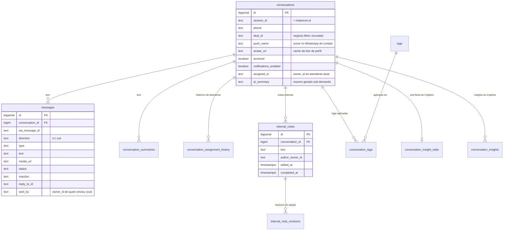
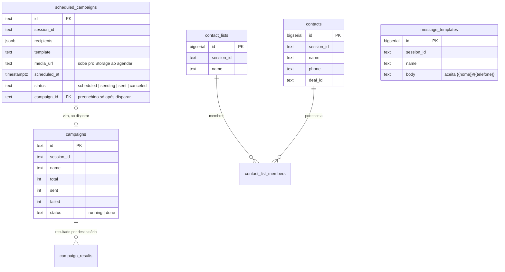
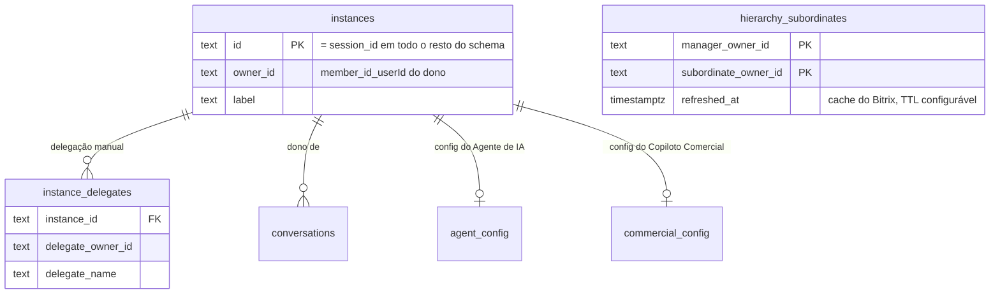
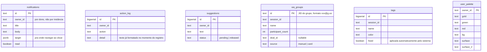

# Schema — WhatsApp ↔ Bitrix24 Gateway

> Diagrama ER derivado de `db/schema.sql` (fonte de verdade real, rodado
> via `node db/migrate.js` — idempotente, todo `create table`/`alter
> table add column` usa `if not exists`). O schema real tem **42
> tabelas**; este documento não cobre cada uma em detalhe extremo, só os
> grupos principais e como se relacionam. Para o propósito exato de cada
> coluna, o comentário SQL em `db/schema.sql` é a fonte mais completa —
> este diagrama é um mapa de navegação, não substitui a leitura do SQL.

## 1. Conversas, mensagens e histórico

Núcleo do projeto: uma conversa é o par `(session_id, phone)`; toda
mensagem, resumo, atribuição, nota e insight de IA se pendura nela.



## 2. Campanhas, agendamento e templates



## 3. Instâncias, delegação e hierarquia



`hierarchy_subordinates` não tem FK direta para `instances` — é um cache
independente de `manager_owner_id → subordinate_owner_id` resolvido via
`department.get`/`user.get` do Bitrix (`BITRIX_HR_WEBHOOK_URL`), consultado
por `src/authz.js::assertOwnsSession` quando a delegação manual não
resolve o acesso.

## 4. Agente de IA (`agent_*`)

Responde automaticamente à primeira mensagem de um lead novo. Base de
conhecimento com busca semântica (pgvector) + aprendizado few-shot por
exemplo aprovado manualmente.

```mermaid
erDiagram
    instances ||--o| agent_config : "1 config por instância"
    instances ||--o{ agent_knowledge_docs : "documentos enviados"
    agent_knowledge_docs ||--o{ agent_knowledge_chunks : "pedaços com embedding"
    instances ||--o{ agent_retry_queue : "fila de reenvio"
    instances ||--o{ agent_example_candidates : "candidatas a exemplo"
    instances ||--o{ agent_examples : "exemplos aprovados"
    agent_example_candidates |o--o| agent_examples : "origem (nullable)"

    agent_config {
        text session_id PK_FK
        boolean active
        text system_message
        text knowledge_text
    }
    agent_knowledge_docs {
        bigserial id PK
        text session_id FK
        text file_name
        text file_type "pdf | docx | txt | md"
        text content "texto já extraído"
        text status "processing | ready | error"
    }
    agent_knowledge_chunks {
        bigserial id PK
        bigint doc_id FK
        text session_id FK
        int chunk_index
        text content
        vector_1536 embedding
    }
    agent_retry_queue {
        bigserial id PK
        text session_id FK
        text phone
        text status "pending | sent | failed"
        int attempts
    }
    agent_example_candidates {
        bigserial id PK
        text session_id FK
        text phone
        text transcript_raw "COM dado sensível — nunca reusado direto"
        text status "pending_review | approved | rejected | anonymization_failed"
        text anonymized_draft
    }
    agent_examples {
        bigserial id PK
        text session_id FK
        bigint candidate_id FK "nullable, on delete set null"
        text anonymized_text "único texto reaproveitado — NUNCA o raw"
        vector_1536 embedding
    }
```

## 5. Copiloto Comercial (`commercial_config`, `conversation_insight_state`, `conversation_insights`) — NOVAS, 2026-08-27

Distinto do Agente de IA: aqui a IA **sugere** para o atendente humano
durante uma conversa em andamento, nunca responde sozinha. Tabelas
adicionadas na Parte EW do `HANDOFF.md` (2026-08-27), ainda **não
validadas contra o banco de produção** (ver `SECURITY.md` §3 e
`ROADMAP.md` §3).

```mermaid
erDiagram
    instances ||--o| commercial_config : "1 config por instância comercial"
    conversations ||--o| conversation_insight_state : "estado de anti-flood"
    conversations ||--o{ conversation_insights : "insights gerados"

    commercial_config {
        text session_id PK_FK
        boolean enabled "nasce false, nunca liga sozinho"
        text playbook "regras do negócio, texto livre"
        jsonb topics "lista fixa mas editável, default 5 tópicos"
    }
    conversation_insight_state {
        bigint conversation_id PK_FK
        timestamptz last_generated_at "checado ANTES de chamar a OpenAI"
        text last_message_id_considered
    }
    conversation_insights {
        bigserial id PK
        bigint conversation_id FK
        text topic
        text title
        text body
        text confidence "high | medium | low"
        text status "active | dismissed | sent"
        text feedback "useful | not_useful, nullable"
        int tokens_used
    }
```

**Por que 3 tabelas próprias, não reaproveitando `internal_notes`**:
ciclos de vida diferentes — um insight tem `topic`/`confidence`/
`feedback`/`status` que uma nota não tem; uma nota tem edição com
histórico (`internal_note_revisions`) que um insight não tem. Misturar
forçaria coluna nula nos dois sentidos (ver comentário original em
`db/schema.sql`).

## 6. Notificações, notas e outras tabelas de suporte



`wa_groups` com `source='card'` (criado pela feature "Criar grupo" no
card do negócio, ou automaticamente pelo Agente de IA desde a Parte EV)
é o único tipo de grupo cujas mensagens recebidas são processadas/salvas
— qualquer outro grupo (`source='manual'`) descarta mensagem recebida
por completo (`src/whatsapp.js::_processIncomingMessage`, flag
`isCardGroup`).

## 7. Extensão pgvector

`agent_knowledge_chunks.embedding` e `agent_examples.embedding` usam o
tipo `vector(1536)` (dimensão fixa do modelo `text-embedding-3-small` da
OpenAI) com índice IVFFlat (`lists = 100`, distância de cosseno) — mudar
de modelo de embedding no futuro exigiria migrar essas duas colunas
(fora de escopo hoje, mesma decisão implícita de fixar em `gpt-4o-mini`
que o resto do app já faz).
